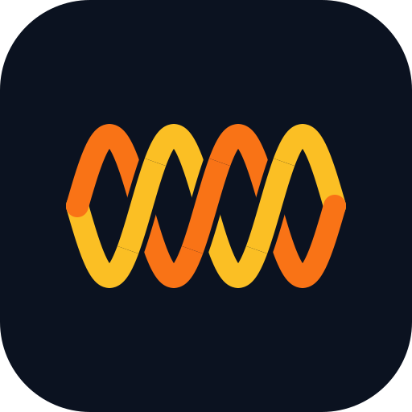

<div align="center">



# Tessitura

**Open source audio plugins, woven by a composer.**


</div>

---

### `tessitura /tes·si·tù·ra/ — n.`

```text
1. the weave of a fabric: threads crossing over and under, until they hold a shape.
2. the range in which a voice sits most naturally.
```

Tessitura is a small studio making **audio plugins in the open**: effects and instruments for film scoring and sound design, built by someone who writes for orchestra and plays for a living, not by a spec sheet.

### What goes here

- 🎛️ **Effects and synths** shaped for cinema, theatre and sound design
- 🔌 **AU and VST3**, made to sit inside Cubase and Logic Pro
- 📖 **Readable source**: if you want to know how it sounds that way, open the code
- 🧵 **Small and finished** over big and unfinished: one plugin, one idea, done well

### Status

First releases coming soon. Each plugin's source will land here when it is ready to be played.

---

<div align="center">

**Michele Tognin** · composer & guitarist, conservatory-trained in guitar and composition  
<sub>Plugins are written in collaboration with AI, directed by a musician's ear.</sub>

</div>
